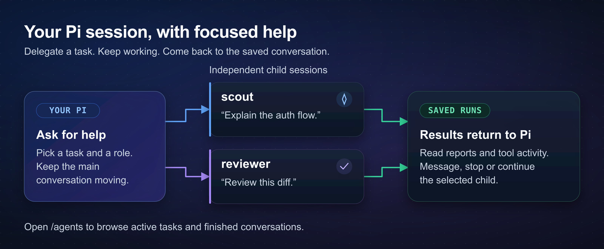

# pi-subagents

Subagents lets you hand a task to another [Pi](https://github.com/earendil-works/pi/tree/main/packages/coding-agent) session while you keep working. Ask a scout to explain unfamiliar code or a reviewer to check your diff, then open their saved conversations when you need the details.



*Your Pi session assigns the work; each child has its own task and conversation, and results return to the same saved parent.*

## Installation

```bash
pi install npm:@fitchmultz/pi-subagents
pi
```

Requires **Pi 1.0.0+** and **Node 24.21.0+** on **macOS or Linux**.

In a new Pi session, try:

```text
Use scout to explain how authentication works in this project.
```

The built-in agents are ready to use. For Git installs, local checkouts and source switching, see the [installation reference](docs/reference.md#installation).

## Try a review

```text
Use reviewer to review this diff for bugs and missing tests.
```

```text
Run parallel reviewers: one for correctness, one for tests, and one for unnecessary complexity.
```

```text
Have worker implement this approved plan, then ask reviewer to check the changes.
```

Background execution is the default. Each child gets a focused assignment and its own saved conversation. Pi can also wait for a result, run a sequence of agents, or reuse a saved workflow. A reviewer runs when you ask for one; installing the extension does not start automatic reviews.

Each child uses your provider accounts and can spend tokens. Children normally inherit Pi's tools, extensions, project instructions and skills. See [tool selection](docs/reference.md#tool-and-extension-selection) and [project trust](docs/reference.md#projecttrust) for restricted profiles.

## Follow, message and continue your agents

The **Agents** area above the editor shows active work and tasks that need attention. Open **`/agents`** or press **Option+Shift+M** on macOS (**Alt+Shift+M** elsewhere) to browse active and finished conversations.

Inside a conversation:

- Read the child's messages, tool activity and saved report.
- Send a message directly to that child.
- Open **F2 Actions** to inspect details, stop the selected child, or continue finished work.
- Press **Esc** to return to Pi without interrupting either agent.

Viewing a finished conversation does not restart it. **Continue** explicitly starts follow-up work from its saved session. Resume the **same saved parent session** after a restart to recover its runs, questions and pending results.

The [agent-view reference](docs/reference.md#try-this-first) covers keyboard shortcuts, history search, drafts and delivery states.

## Pick a specialist

| What you need | Built-in agents |
| --- | --- |
| Understand the code or gather evidence | `scout`, `context-builder`, `researcher` |
| Plan or challenge a decision | `planner`, `oracle` |
| Implement or repair a change | `worker`, `debugger`, `fixer`, `delegate` |
| Review correctness, security or complexity | `reviewer`, `reviewer-gpt`, `reviewer-claude`, `reviewer-security`, `reviewer-ponytail` |
| Design, write or monitor | `ui-designer`, `writer`, `watcher` |

Bundled roles have model and fallback defaults. Ask Pi to show the effective profiles, and choose a model available through your account if a default is unavailable. You can [override a model](docs/reference.md#changing-a-builtin-agents-model) without copying the agent file.

Custom agents live in `~/.pi/agent/agents/` or your project's `.pi/agents/`. [Agent profiles and saved chains](docs/reference.md#agents-and-chains) explain precedence, frontmatter and reusable workflows.

## Direct commands

You can also launch an agent directly:

| Command | Example |
| --- | --- |
| One agent | `/run reviewer "Review this diff"` |
| A sequence | `/chain scout "Map auth" -> planner "Plan a refactor"` |
| Parallel tasks | `/parallel scout "Inspect frontend" -> scout "Inspect backend"` |
| A saved workflow | `/run-chain scout-planner -- refactor authentication` |
| Setup diagnostics | `/subagents-doctor` |

Saved workflows use names you define; the example assumes you've [created a chain](docs/reference.md#chain-files) called `scout-planner`.

Add `--fg` if you want to wait for the result. This works unless you've configured Pi to force background execution. See the [command reference](docs/reference.md#direct-commands) for options, forked context and per-step settings.

## Coordinate with other Pi sessions

Intercom is included in the same install. It lets local Pi sessions exchange messages and lets a child ask its parent for a decision while work is running.

Start with the [Intercom guide](docs/intercom.md). For a remote Linux agent, the optional [secure bridge](docs/intercom-bridge.md) uses mutual TLS over an SSH reverse forward.

If you previously installed standalone `pi-intercom`, [remove its old package entry](docs/reference.md#bundled-intercom) to avoid loading it twice.

## Update and troubleshoot

Before updating an in-use extension, checkpoint work and **fully quit every Pi session using that installation**. Update from a separate terminal, then start fresh Pi processes:

```bash
pi update --extension npm:@fitchmultz/pi-subagents
```

Resume the same saved parent, for example with `pi --session /path/to/parent.jsonl`. `/reload` can refresh supported settings, skills and prompts, but it does not reliably activate changed JavaScript.

Run `/subagents-doctor` if delegation or messaging feels misconfigured. [Installation and recovery details](docs/reference.md#installation) cover Git updates, local rebuilds and broker restarts; [host limitations](docs/intercom.md#limitations) cover delivery boundaries. Indexed history requires the qualified built-in SQLite binding described in the [performance guide](docs/performance.md).

## Go deeper

- [Full reference](docs/reference.md): commands, profiles, chains, tool parameters, configuration, acceptance and saved run records.
- [Development and validation](docs/development.md): builds, full CI, compatibility checks and optional live-model smoke tests.
- [Performance](docs/performance.md): saved-history indexing, usage accounting and host startup costs.
- [Example prompts](prompts/): review, research, planning and cleanup workflows.
- [Changelog](CHANGELOG.md): changes by version.

## License

[MIT](LICENSE).
